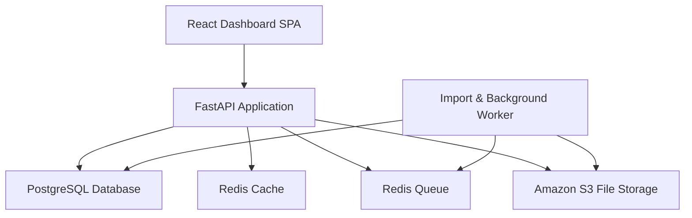
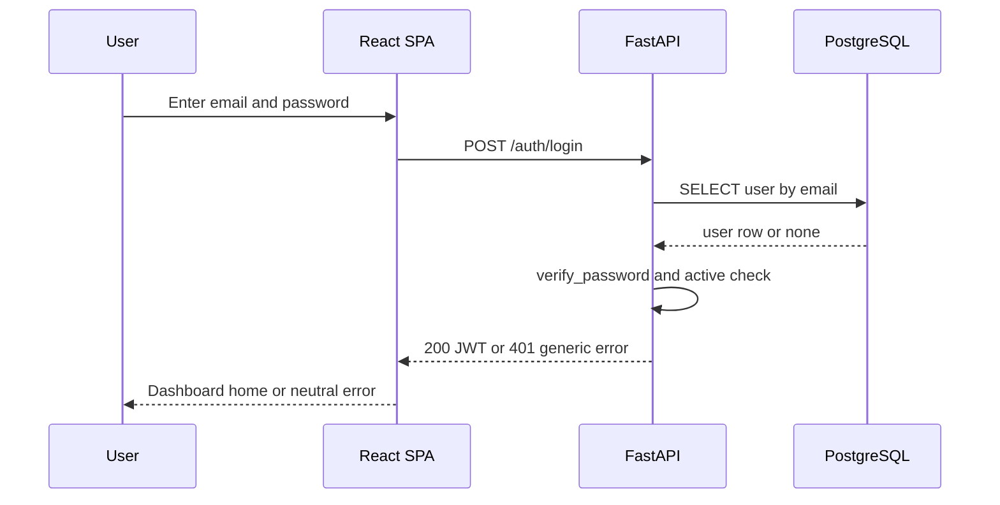
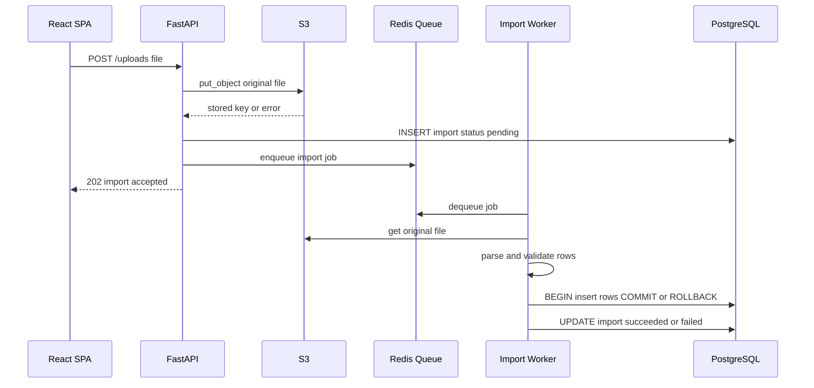
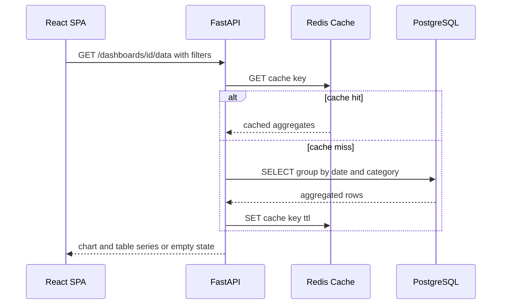
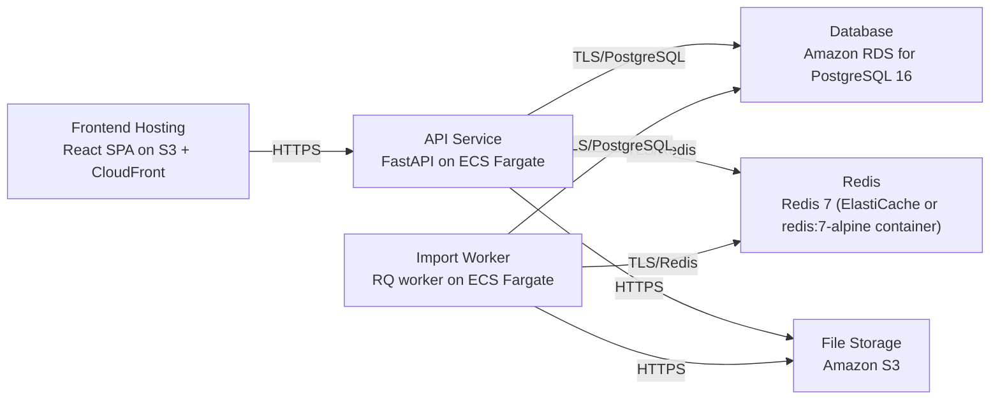

# Architecture

> Maintained by QuorQ AI SDLC. Text between `sdlc:auto` markers is regenerated; anything outside them is yours and is kept.

<!-- sdlc:auto:start narrative -->
## Overview

### ARCH-001 · approved · source: architecture:overview

Approved v1 architecture: React 19 responsive SPA, FastAPI 0.115 backend, PostgreSQL 16, Redis (cache + queue) and S3, all on AWS — exactly matching the approved requirements stack.

Components: web_frontend (React Dashboard SPA, React 19) - sign-in, user/data management, manual entry, upload, configurable dashboards. api_backend (FastAPI Application, FastAPI 0.115) - auth, authorisation, user mgmt, records, upload intake, dashboard config, cached aggregation queries. import_worker (Import & Background Worker, FastAPI 0.115) - consumes queued jobs, parses/validates files, stores originals in S3, imports rows transactionally. postgres_db (PostgreSQL 16) - users, roles, records, dashboards, chart configs, import history, filtering/aggregation. redis_cache (Redis 7) - caches aggregation results. redis_queue (Redis 7) - holds background import jobs. s3_store (Amazon S3) - durable original file storage. Technology decisions: Frontend React 19 (alternatives Vue, Angular) chosen for interactive responsive dashboards; Backend FastAPI 0.115 (alternatives Django REST Framework, Flask) chosen for Python's spreadsheet/aggregation tooling and lightness at scale; Database PostgreSQL 16 (alternatives MySQL, SQLite) chosen for relational filtering/aggregation plus unified user/role storage; Cloud AWS (alternatives GCP, Azure) chosen for one-account hosting (ECS Fargate), RDS, Redis and S3 at low cost for a few hundred users.

**Related:** EPIC-001, EPIC-002, EPIC-003, EPIC-004

- ⚠ No architecture diagrams or explicit capacity/sizing beyond NFR-007's 'few hundred users' target were provided.

### ARCH-002 · approved · source: architecture:critical_path:sign-in

Email/password sign-in critical path: credential verification, non-revealing error handling, and JWT issuance carrying role.

A member submits credentials; api_backend verifies against the stored bcrypt password_hash in postgres_db, rejects with a non-revealing error on mismatch or deactivated account (satisfies NFR-002/NFR-003), and on success issues a JWT carrying the user's role for subsequent role-based authorisation checks.

**Related:** US-001, US-002, NFR-002, NFR-003

### ARCH-003 · approved · source: architecture:critical_path:upload-import

CSV/Excel upload and background import critical path: S3 storage, pending import record, queued worker, transactional row import.

An admin uploads a file via api_backend; the original is stored in s3_store, a pending import record is created in postgres_db, and a job is enqueued on redis_queue. import_worker parses and validates the file, then imports rows in a single transaction, marking the import succeeded or failed with no partial data left behind (satisfies NFR-004, NFR-006, NFR-009).

**Related:** US-005, US-006, NFR-004, NFR-006, NFR-009

### ARCH-004 · approved · source: architecture:critical_path:dashboard-load

Dashboard load critical path: cached aggregation lookup with fallback to grouped SQL aggregation.

A member opens a dashboard with date/category filters; api_backend builds a cache key, returns cached aggregates from redis_cache when present, otherwise runs the grouped SQL aggregation against postgres_db, caches the result, and returns chart-ready series to web_frontend (satisfies NFR-005; empty state handling satisfies NFR-010).

**Related:** US-007, US-009, NFR-005, NFR-010

### ARCH-005 · approved · source: architecture:entities

Core PostgreSQL data model: users, data_records, imports, dashboards, charts.

users: id, email, password_hash, role, is_active, created_at. data_records: id, record_date, category, metric_name, metric_value, source, import_id, created_by, created_at. imports: id, file_name, s3_key, uploaded_by, status, rows_imported, error_message, created_at. dashboards: id, name, created_by, created_at. charts: id, dashboard_id, chart_type, title, config, position.

**Related:** US-001, US-003, US-004, US-005, US-006, US-008

### ARCH-006 · approved · source: architecture:endpoints

REST API surface for auth, user/record/upload management, dashboards and charts.

POST /auth/login - authenticate, returns JWT, generic failure error. POST /auth/logout - end session. GET /users, POST /users, PATCH /users/{id} - admin-only user listing/creation/edit-deactivate. POST /records, PATCH /records/{id}, DELETE /records/{id} - admin-only manual record create/edit/delete with validation. POST /uploads - admin-only file upload, stores in S3, enqueues import, returns pending import. GET /uploads - upload history. GET /dashboards, POST /dashboards - list/create dashboards (create admin-only). POST /dashboards/{id}/charts, PATCH /charts/{id}, DELETE /charts/{id} - admin-only chart add/reconfigure/remove. GET /dashboards/{id}/data - filtered, cached chart/table series with empty-state support.

**Related:** US-001, US-002, US-003, US-004, US-005, US-007, US-008, US-009

### ARCH-007 · approved · source: architecture:deployment_nodes

Planned AWS deployment topology for frontend, API, worker, database, cache/queue and file storage.

Frontend Hosting: React SPA static build on S3 + CloudFront. API Service: FastAPI on ECS Fargate (Python 3.12 / Uvicorn). Import Worker: RQ worker on ECS Fargate (Python 3.12). Database: Amazon RDS for PostgreSQL 16. Redis: Redis 7 via ElastiCache or redis:7-alpine container (serves both cache and queue roles). File Storage: Amazon S3 bucket.

**Related:** NFR-007

- ⚠ This is the planned topology from the architecture phase; no deployment phase input exists yet confirming any of these nodes were actually provisioned.
<!-- sdlc:auto:end narrative -->

<!-- sdlc:auto:start building-blocks -->
## Building Block View

| ID | Name | Technology | Responsibility | Depends on |
|---|---|---|---|---|
| web_frontend | React Dashboard SPA | React 19 | Responsive web UI for sign-in, user/data management, manual data entry, file upload, and configurable dashboards with bar/line/table charts and date/category filters. | api_backend |
| api_backend | FastAPI Application | FastAPI 0.115 | REST API handling authentication, role-based authorisation, user management, manual records, file upload intake, dashboard configuration, and cached aggregation queries. | postgres_db, redis_cache, redis_queue, s3_store |
| import_worker | Import & Background Worker | FastAPI 0.115 | Consumes queued jobs to parse and validate CSV/Excel files, store originals in S3, and import rows transactionally so imports are all-or-nothing. | postgres_db, redis_queue, s3_store |
| postgres_db | PostgreSQL Database | PostgreSQL 16 | Stores users, roles, data records, dashboards, chart configs, and import history; performs date/category filtering and aggregation. | — |
| redis_cache | Redis Cache | Redis 7 | Caches repeated date/category dashboard aggregation results to keep repeated views fast and offload the database. | — |
| redis_queue | Redis Queue | Redis 7 | Holds background jobs for spreadsheet parsing/validation/import so uploads do not stall web requests. | — |
| s3_store | Amazon S3 File Storage | Amazon S3 | Durable storage for original uploaded CSV/Excel files, referenced from import records. | — |

<!-- sdlc:auto:end building-blocks -->

<!-- sdlc:auto:start runtime -->
## Runtime View

### Email/password sign-in

A member submits credentials; the backend verifies against the stored bcrypt hash, rejects with a non-revealing error on mismatch or deactivated account, and issues a JWT carrying the role.

- **Components:** web_frontend, api_backend, postgres_db
- **Modules:** auth.router, auth.service, auth.security
- **Key functions:** login(email, password), verify_password(plain, hash), create_access_token(user_id, role), get_current_user(token)

### CSV/Excel upload and background import

An admin uploads a file; the backend stores the original in S3, records a pending import, and enqueues a job. The worker parses and validates, then imports rows in one transaction, marking the import succeeded or failed with no partial data.

- **Components:** web_frontend, api_backend, s3_store, redis_queue, import_worker, postgres_db
- **Modules:** uploads.router, uploads.service, storage.s3, worker.import_job, records.service
- **Key functions:** create_upload(file, user), put_object(bucket, key, bytes), enqueue(import_file, import_id), run_import(import_id), validate_rows(df), bulk_insert_records(rows)

### Dashboard load with cached aggregation

A member opens a dashboard with date/category filters; the backend builds a cache key, returns cached aggregates when present, otherwise runs the grouped SQL aggregation, caches it, and returns chart-ready series.

- **Components:** web_frontend, api_backend, redis_cache, postgres_db
- **Modules:** dashboards.router, dashboards.service, aggregation.query, cache.redis
- **Key functions:** get_dashboard_data(dashboard_id, filters), build_cache_key(dashboard_id, filters), cache_get(key), aggregate_records(filters, group_by), cache_set(key, value, ttl)

<!-- sdlc:auto:end runtime -->

<!-- sdlc:auto:start deployment-view -->
## Deployment View

| Name | Service | Runtime | Scaling | Environment |
|---|---|---|---|---|
| Frontend Hosting | React SPA on S3 + CloudFront | Static build | CDN edge | dev |
| API Service | FastAPI on ECS Fargate | Python 3.12 / Uvicorn | 1-2 tasks | dev |
| Import Worker | RQ worker on ECS Fargate | Python 3.12 | 1 task | dev |
| Database | Amazon RDS for PostgreSQL 16 | PostgreSQL 16 | Single instance | dev |
| Redis | Redis 7 (ElastiCache or redis:7-alpine container) | Redis 7 | Single node | dev |
| File Storage | Amazon S3 | S3 bucket | Managed | dev |

| Source | Target | Protocol |
|---|---|---|
| Frontend Hosting | API Service | HTTPS |
| API Service | Database | TLS/PostgreSQL |
| API Service | Redis | TLS/Redis |
| API Service | File Storage | HTTPS |
| Import Worker | Redis | TLS/Redis |
| Import Worker | Database | TLS/PostgreSQL |
| Import Worker | File Storage | HTTPS |

<!-- sdlc:auto:end deployment-view -->

<!-- sdlc:auto:start decisions -->
## Architecture Decisions

| Layer | Choice | ADR |
|---|---|---|
| Frontend | React 19 | [ADR-0001](adr/frontend.md) |
| Backend | FastAPI 0.115 | [ADR-0002](adr/backend.md) |
| Database | PostgreSQL 16 | [ADR-0003](adr/database.md) |
| Cloud | AWS | [ADR-0004](adr/cloud.md) |
<!-- sdlc:auto:end decisions -->

<!-- sdlc:auto:start links -->
## Related Documents

- [Data Model](data-model.md)
- [API Specification](api/openapi.yaml)
- [Architecture Decision Records](adr/README.md)
<!-- sdlc:auto:end links -->
