# Data Model

<!-- sdlc:auto:start entities -->
### users

| Field | Type | PK | FK | Nullable |
|---|---|---|---|---|
| id | uuid | True | — | False |
| email | varchar | False | — | False |
| password_hash | varchar | False | — | False |
| role | varchar | False | — | False |
| is_active | boolean | False | — | False |
| created_at | timestamptz | False | — | False |

### data_records

| Field | Type | PK | FK | Nullable |
|---|---|---|---|---|
| id | uuid | True | — | False |
| record_date | date | False | — | False |
| category | varchar | False | — | False |
| metric_name | varchar | False | — | False |
| metric_value | numeric | False | — | False |
| source | varchar | False | — | False |
| import_id | uuid | False | imports.id | True |
| created_by | uuid | False | users.id | True |
| created_at | timestamptz | False | — | False |

### imports

| Field | Type | PK | FK | Nullable |
|---|---|---|---|---|
| id | uuid | True | — | False |
| file_name | varchar | False | — | False |
| s3_key | varchar | False | — | False |
| uploaded_by | uuid | False | users.id | False |
| status | varchar | False | — | False |
| rows_imported | integer | False | — | True |
| error_message | text | False | — | True |
| created_at | timestamptz | False | — | False |

### dashboards

| Field | Type | PK | FK | Nullable |
|---|---|---|---|---|
| id | uuid | True | — | False |
| name | varchar | False | — | False |
| created_by | uuid | False | users.id | True |
| created_at | timestamptz | False | — | False |

### charts

| Field | Type | PK | FK | Nullable |
|---|---|---|---|---|
| id | uuid | True | — | False |
| dashboard_id | uuid | False | dashboards.id | False |
| chart_type | varchar | False | — | False |
| title | varchar | False | — | False |
| config | jsonb | False | — | False |
| position | integer | False | — | False |
<!-- sdlc:auto:end entities -->

<!-- sdlc:auto:start relationships -->
| Source | Target | Type |
|---|---|---|
| users | imports | one-to-many |
| users | data_records | one-to-many |
| imports | data_records | one-to-many |
| dashboards | charts | one-to-many |

```mermaid
erDiagram
  users {
    uuid id PK
    varchar email
    varchar password_hash
    varchar role
    boolean is_active
    timestamptz created_at
  }
  data_records {
    uuid id PK
    date record_date
    varchar category
    varchar metric_name
    numeric metric_value
    varchar source
    uuid import_id FK
    uuid created_by FK
    timestamptz created_at
  }
  imports {
    uuid id PK
    varchar file_name
    varchar s3_key
    uuid uploaded_by FK
    varchar status
    integer rows_imported
    text error_message
    timestamptz created_at
  }
  dashboards {
    uuid id PK
    varchar name
    uuid created_by FK
    timestamptz created_at
  }
  charts {
    uuid id PK
    uuid dashboard_id FK
    varchar chart_type
    varchar title
    jsonb config
    integer position
  }
  users ||--o{ imports : "one-to-many"
  users ||--o{ data_records : "one-to-many"
  imports ||--o{ data_records : "one-to-many"
  dashboards ||--o{ charts : "one-to-many"
```

<!-- sdlc:auto:end relationships -->

<!-- sdlc:auto:start er-diagram -->

<!-- sdlc:auto:end er-diagram -->
