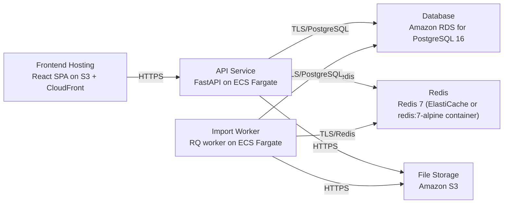

# Deployment Guide

> Maintained by QuorQ AI SDLC. Text between `sdlc:auto` markers is regenerated; anything outside them is yours and is kept.

<!-- sdlc:auto:start how-it-deploys -->
Pushes to `main` run `.github/workflows/deploy.yml`, which builds the API image (if there is a backend) and deploys the SPA to AWS Amplify. Commits touching only `docs/sdlc/**` don't deploy. Deployments can also be started from the platform's Deployment tab.
<!-- sdlc:auto:end how-it-deploys -->

<!-- sdlc:auto:start environments -->
| Name | Service | Runtime | Scaling | Environment |
|---|---|---|---|---|
| Frontend Hosting | React SPA on S3 + CloudFront | Static build | CDN edge | dev |
| API Service | FastAPI on ECS Fargate | Python 3.12 / Uvicorn | 1-2 tasks | dev |
| Import Worker | RQ worker on ECS Fargate | Python 3.12 | 1 task | dev |
| Database | Amazon RDS for PostgreSQL 16 | PostgreSQL 16 | Single instance | dev |
| Redis | Redis 7 (ElastiCache or redis:7-alpine container) | Redis 7 | Single node | dev |
| File Storage | Amazon S3 | S3 bucket | Managed | dev |
<!-- sdlc:auto:end environments -->

<!-- sdlc:auto:start live -->
_Not deployed yet._
<!-- sdlc:auto:end live -->

<!-- sdlc:auto:start topology -->

<!-- sdlc:auto:end topology -->
